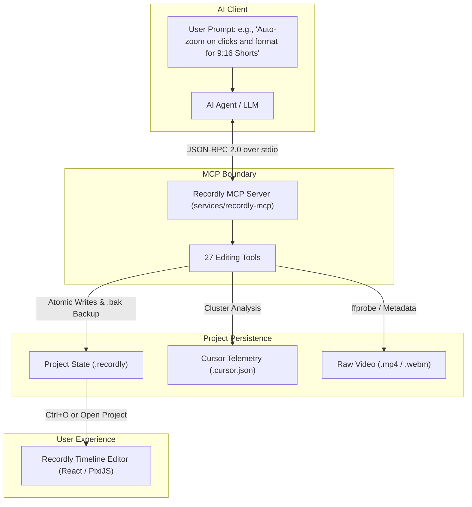
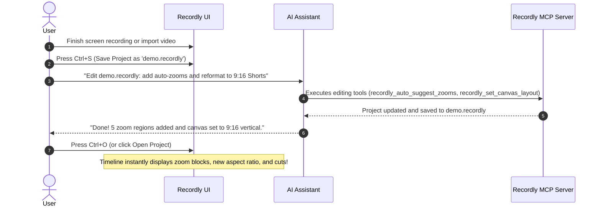

# Recordly AI Editing MCP Server

A [Model Context Protocol (MCP)](https://modelcontextprotocol.io) server that empowers AI agents—including **Antigravity**, **Claude Desktop**, **Cursor**, **Cline**, and **Windsurf**—to edit Recordly video projects autonomously through natural language.

---

## 1. Overview & Architecture

Recordly stores its timeline sequences, camera zoom regions, subtitles, and canvas styling in portable JSON-based `.recordly` project files (schema version 2) accompanied by `.cursor.json` mouse telemetry streams.

The **Recordly MCP Server** sits between any MCP-compliant AI assistant and Recordly's project engine:



### Key Architectural Characteristics
* **Zero Dependency on Running Electron App:** The MCP server operates directly on project files and telemetry on disk. It can edit projects before, during, or after Recordly is launched.
* **Non-Destructive Atomic Persistence:** Every project write is performed atomically via temporary files and automatically creates a `.bak` safety backup.
* **Deterministic Mathematical Modeling:** Zoom clustering, timeline clip stitching, coordinate clamping, and canvas aspect ratio re-framing are computed using pure mathematical utilities mirroring Recordly's frontend algorithms.

---

## 2. Quick Setup & Client Configuration

The MCP server is located at `services/recordly-mcp` and compiles to `services/recordly-mcp/dist/index.js`.

### 2.1. Compilation
From the Recordly repository root:
```bash
npm run build:mcp
```
*(Or directly inside `services/recordly-mcp`: `npm install && npm run build`)*.

---

### 2.2. Client Configuration Snippets

#### Antigravity / Gemini
Configured in `~/.gemini/config/mcp_config.json` (global) or `.agents/mcp_config.json` (workspace):
```json
{
  "mcpServers": {
    "recordly-editor": {
      "command": "node",
      "args": [
        "/home/lalitmukesh/Downloads/Recordly/services/recordly-mcp/dist/index.js"
      ],
      "disabled": false
    }
  }
}
```

#### Claude Desktop (`claude_desktop_config.json`)
* **Linux:** `~/.config/Claude/claude_desktop_config.json`
* **macOS:** `~/Library/Application Support/Claude/claude_desktop_config.json`
* **Windows:** `%APPDATA%\Claude\claude_desktop_config.json`

```json
{
  "mcpServers": {
    "recordly-editor": {
      "command": "node",
      "args": [
        "/home/lalitmukesh/Downloads/Recordly/services/recordly-mcp/dist/index.js"
      ]
    }
  }
}
```

#### Cursor IDE (`.cursor/mcp.json`)
```json
{
  "mcpServers": {
    "recordly-editor": {
      "command": "node",
      "args": [
        "/home/lalitmukesh/Downloads/Recordly/services/recordly-mcp/dist/index.js"
      ]
    }
  }
}
```

#### Cline / Roo Code / Windsurf
Add a new stdio server:
* **Command:** `node`
* **Args:** `["/absolute/path/to/Recordly/services/recordly-mcp/dist/index.js"]`

---

## 3. Complete Tool Reference (27 Tools)

### 📁 Project Management
| Tool Name | Parameters | Description |
| :--- | :--- | :--- |
| `recordly_list_projects` | `searchDir?: string` | Scans Recordly library directories (`~/.config/Recordly/projects`, `recordings`) and custom folders for `.recordly` files. |
| `recordly_load_project` | `projectPath: string` | Reads and parses full project state: active video path, clip count, zoom regions, captions, and visual settings. |
| `recordly_create_project` | `videoPath: string`, `projectName?: string`, `targetDir?: string` | Initializes a brand new `.recordly` project pointing to a video recording. |
| `recordly_save_project` | `projectPath: string`, `projectData: object` | Atomically writes an updated `EditorProjectData` payload to disk. |

---

### ✂️ Timeline & Clip Editing
| Tool Name | Parameters | Description |
| :--- | :--- | :--- |
| `recordly_get_timeline` | `projectPath: string` | Returns timeline breakdown: duration, clip sequence, source ranges, cut points, and audio levels. |
| `recordly_split_clip` | `projectPath: string`, `clipId: string`, `splitTimestampMs: number` | Splits a video clip at millisecond mark $t$, generating two independent contiguous clips. |
| `recordly_trim_clip` | `projectPath: string`, `clipId: string`, `newStartMs?: number`, `newEndMs?: number` | Adjusts clip start/end boundaries to cut dead air, pauses, or mistakes. |
| `recordly_delete_clip` | `projectPath: string`, `clipId: string` | Removes a clip and automatically recalibrates subsequent timeline start timestamps. |
| `recordly_reorder_clips` | `projectPath: string`, `orderedClipIds: string[]` | Reorders clips into a new sequence and recalculates timeline playback offsets. |
| `recordly_set_clip_properties` | `projectPath: string`, `clipId: string`, `speed?: number`, `volume?: number`, `muted?: boolean` | Sets playback speed (e.g. 1.25x, 1.5x, 2.0x), volume (0–1), or audio muting. |

---

### 🔍 Auto-Zoom & Camera Control
| Tool Name | Parameters | Description |
| :--- | :--- | :--- |
| `recordly_list_zoom_regions` | `projectPath: string` | Lists all camera zoom keyframe regions, depths, focus coordinates, and easing curves. |
| `recordly_add_zoom_region` | `projectPath: string`, `startMs: number`, `endMs: number`, `focusX: number`, `focusY: number`, `depth?: number`, `mode?: "auto" \| "manual"` | Inserts a camera zoom targeting normalized coordinates $(cx, cy) \in [0, 1]$ with zoom depth 1–6. |
| `recordly_update_zoom_region` | `projectPath: string`, `zoomId: string`, `startMs?: number`, `endMs?: number`, `focusX?: number`, `focusY?: number`, `depth?: number` | Modifies focus coordinates, duration, or zoom intensity on an existing keyframe. |
| `recordly_delete_zoom_region` | `projectPath: string`, `zoomId?: string`, `clearAll?: boolean` | Removes an individual zoom keyframe or clears all zoom keyframes on the timeline. |
| `recordly_auto_suggest_zooms` | `projectPath: string`, `applyToProject?: boolean`, `replaceExisting?: boolean`, `mergeGapMs?: number`, `depth?: number` | Analyzes `.cursor.json` telemetry, clusters consecutive clicks, computes centroids, and adds auto-zooms. |

---

### 💬 Captions & Subtitles
| Tool Name | Parameters | Description |
| :--- | :--- | :--- |
| `recordly_get_captions` | `projectPath: string` | Retrieves all subtitle cues (`id`, `startMs`, `endMs`, `text`) and typography settings. |
| `recordly_set_captions` | `projectPath: string`, `cues: CaptionCue[]` | Overwrites or bulk-imports complete subtitle tracks (e.g., from Whisper or LLM translations). |
| `recordly_add_caption_cue` | `projectPath: string`, `text: string`, `startMs: number`, `endMs: number` | Adds a single subtitle cue. |
| `recordly_update_caption_cue` | `projectPath: string`, `cueId: string`, `text?: string`, `startMs?: number`, `endMs?: number` | Edits subtitle text or timing. |
| `recordly_delete_caption_cue` | `projectPath: string`, `cueId?: string`, `clearAll?: boolean` | Removes a subtitle cue or wipes all captions. |
| `recordly_set_caption_style` | `projectPath: string`, `position?: string`, `style?: string`, `color?: string`, `fontFamily?: string`, `fontSize?: number` | Sets subtitle visual style (`highlight`, `classic`, `karaoke`), font, color, and positioning. |

---

### 🎨 Canvas, Framing & Cursor Polish
| Tool Name | Parameters | Description |
| :--- | :--- | :--- |
| `recordly_set_canvas_background` | `projectPath: string`, `wallpaper?: string`, `backgroundBlur?: number`, `shadowIntensity?: number` | Configures gradient presets (e.g., `'aurora'`, `'mesh-gradient-1'`), solid colors, blur, and drop shadow. |
| `recordly_set_canvas_layout` | `projectPath: string`, `aspectRatio?: string`, `padding?: number \| object`, `borderRadius?: number` | Changes aspect ratio (`16:9`, `9:16` vertical, `1:1`, `4:5`), screen padding margins, and corner roundness. |
| `recordly_set_cursor_effects` | `projectPath: string`, `showCursor?: boolean`, `cursorStyle?: string`, `cursorSize?: number`, `cursorSmoothing?: number`, `clickEffect?: string`, `clickEffectColor?: string`, `motionBlur?: number`, `clickBounce?: number` | Configures virtual cursor pointer style (`macos`, `windows11`, `tahoe`, `dot`), scale, smoothing, and click ripples (`spotlight`, `ripple`, `echo`). |
| `recordly_set_webcam_overlay` | `projectPath: string`, `enabled?: boolean`, `positionPreset?: string`, `size?: number`, `roundness?: number`, `mirror?: boolean` | Adjusts webcam overlay corner/preset (`bottom-right`, etc.), circular roundness, size, and mirror flip. |

---

### 🔎 Probes & Analysis
| Tool Name | Parameters | Description |
| :--- | :--- | :--- |
| `recordly_probe_video` | `filePath: string` | Inspects video resolution, framerate, duration, bitrate, and codec streams via `ffprobe`. |
| `recordly_get_cursor_telemetry` | `targetPath: string`, `limitSamples?: number` | Inspects recorded mouse coordinates, click frequency, and movement samples. |

---

## 4. Interactive Human-in-the-Loop Workflow



---

## 5. Cookbook: Common Prompt Recipes

### Recipe 1: One-Click Auto-Zoom from Telemetry
> *"Open `recording-1.recordly`, analyze where I clicked during the recording, and generate auto-zoom keyframes with 1.5x zoom depth."*

### Recipe 2: Repurpose Landscape Demo to TikTok / Shorts / Reels (9:16)
> *"Convert `product-walkthrough.recordly` into a 9:16 vertical video for YouTube Shorts. Add 36px padding around the app window, set corner radius to 16px, and apply the 'obsidian' dark gradient wallpaper."*

### Recipe 3: Rough Cut (Cut Silence & Filler)
> *"On the timeline for `tutorial.recordly`, trim out the first 3.5 seconds before I start speaking, and cut out the dead air pause between 00:24 and 00:31."*

### Recipe 4: Professional Cursor Polish
> *"In `feature-overview.recordly`, enable the macOS cursor style, scale it up to 1.35x, set smoothing to 0.8, and add a blue spotlight ripple effect on every mouse click."*

### Recipe 5: Karaoke-Style Subtitles
> *"Add subtitle captions to `demo.recordly` with the 'karaoke' animation style, yellow highlight color (`#FACC15`), positioned at the bottom-center with 28px font."*

---

## 6. Developer & Verification Guide

### Running Handshake Tests
To verify server initialization and tool availability programmatically over stdio:
```bash
node -e "
import { spawn } from 'node:child_process';
const proc = spawn('node', ['services/recordly-mcp/dist/index.js']);
proc.stdout.on('data', d => console.log('MCP Output:', d.toString()));
proc.stdin.write(JSON.stringify({
  jsonrpc: '2.0',
  id: 1,
  method: 'initialize',
  params: { protocolVersion: '2024-11-05', capabilities: {}, clientInfo: { name: 'test', version: '1.0' } }
}) + '\n');
"
```

### Adding New Tools
New tools can be registered under `services/recordly-mcp/src/tools/` using the standard `McpServer.tool()` API and exported in `services/recordly-mcp/src/index.ts`. Recompile with `npm run build:mcp`.
